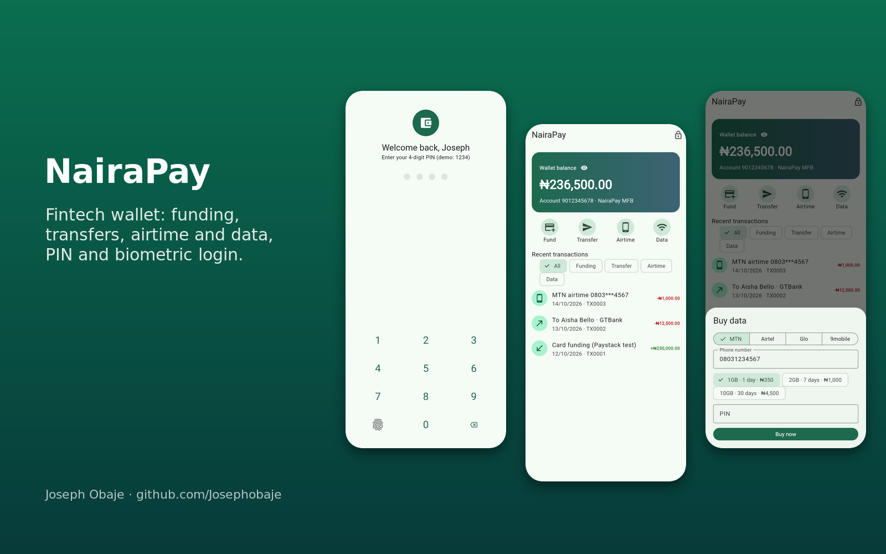
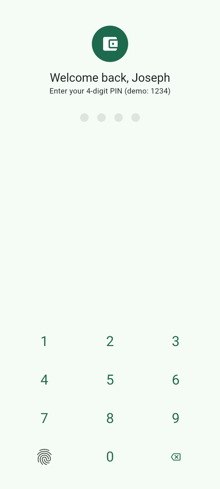
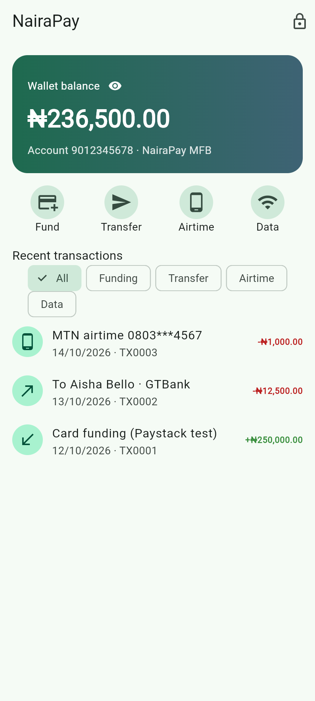
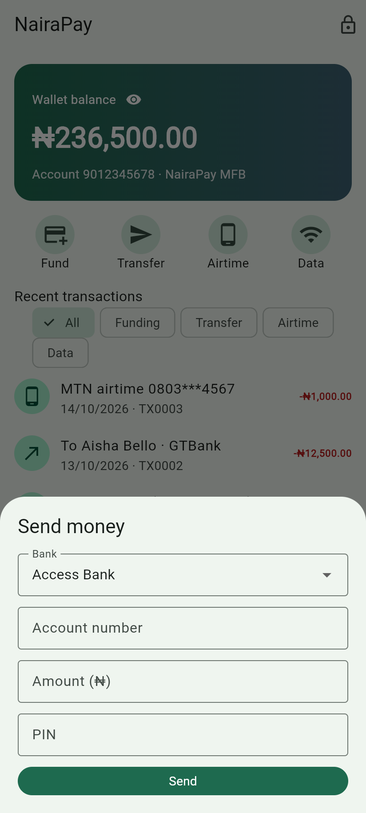
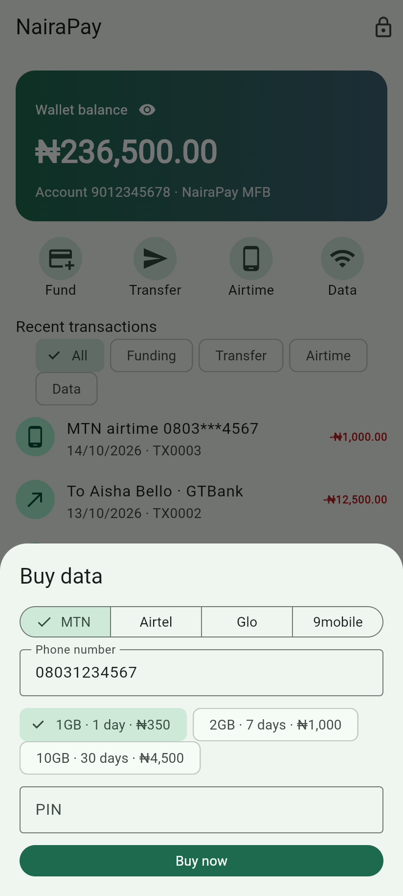
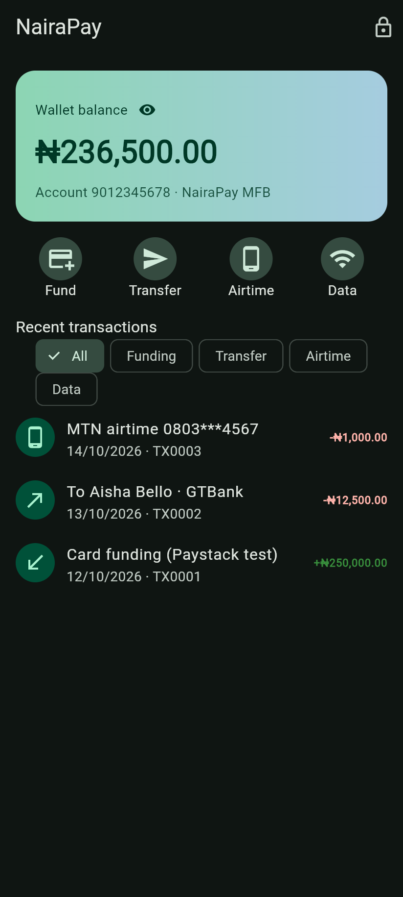

# NairaPay: Flutter Fintech Wallet App


A **digital wallet app in Flutter** built for the Nigerian market: fund your wallet by card (Paystack test-mode mock), send money to any Nigerian bank, buy **airtime and data** for MTN, Airtel, Glo and 9mobile, and review your **transaction history**. The wallet is protected by a **4-digit PIN with lockout** and a **mocked biometric (fingerprint) login**. All money is handled in kobo and shown with proper **Naira formatting**.



| PIN login | Home | Transfer | Buy data | Dark mode |
| --- | --- | --- | --- | --- |
|  |  |  |  |  |

## Features

- **Security**: PIN keypad, 3-attempt lockout, fingerprint unlock through a `BiometricAuth` interface (`MockBiometric` in the demo, swap for `local_auth`), change PIN, lock button, hide balance
- **Fund wallet**: Paystack test-mode mock, minimum ₦100
- **Bank transfers**: bank picker, 10-digit NUBAN validation, demo account-name lookup, PIN confirmation, ₦500,000 daily limit
- **Airtime and data**: network selector, Nigerian phone validation (`0803...`), data plans, masked numbers in history
- **Transaction history** with filters (funding, transfer, airtime, data), credit/debit colours and IDs
- **Money done right**: integer kobo everywhere, `naira()` formatter (₦12,345.50)
- Material 3, light and dark mode

## Tech stack

Flutter 3, Dart 3, provider (ChangeNotifier), Material 3, flutter_test

## Getting started

```bash
git clone https://github.com/Josephobaje/flutter-fintech-wallet-app.git
cd flutter-fintech-wallet-app
flutter pub get
flutter run       # demo PIN: 1234
flutter test      # 12 tests
```

## Going live

Wallet balances must live on a server ledger, never on the device. Use Paystack or Flutterwave for funding and payouts (secret keys on the server), a VTU provider API for airtime/data, `local_auth` for biometrics and `flutter_secure_storage` for tokens.

## Project structure

```text
lib/
  main.dart     # app + lock/home routing
  wallet.dart   # Wallet model: PIN, biometrics, ledger, transfers, bills, ₦ formatter
  screens.dart  # lock screen, home, history, fund/transfer/airtime/data sheets
test/           # 10 unit tests + 2 widget tests
```

## Author

**Joseph Obaje**, Full Stack Developer (PHP, Python, Flutter) and Cybersecurity Specialist

- GitHub: [@Josephobaje](https://github.com/Josephobaje)
- LinkedIn: [joseph-obaje](https://www.linkedin.com/in/joseph-obaje)
- Email: [josephobaje264@gmail.com](mailto:josephobaje264@gmail.com)

## License

Released under the [MIT License](LICENSE). © 2026 Joseph Obaje
